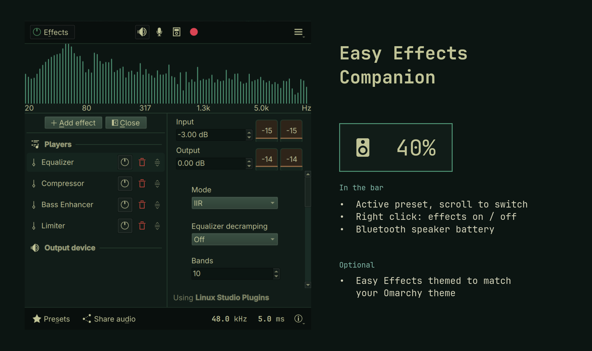

# Easy Effects Companion for Omarchy

A bar widget for [Easy Effects](https://github.com/wwmm/easyeffects) on Omarchy. It shows which output preset is active, turns effects on and off, switches presets, and shows the battery of the Bluetooth speaker or headphones you are playing to. An opt-in setting recolors Easy Effects to match your Omarchy theme and keeps it matched when you switch themes.



## What it does

- **Badge.** A speaker or headphones icon when the output is Bluetooth, an equalizer icon otherwise. When the Bluetooth device reports its battery, the level appears next to the icon. The badge dims while effects are bypassed or Easy Effects is not running, and turns the urgent color when the battery is low.
- **Clicks.** Left click opens Easy Effects. Right click toggles Easy Effects' global bypass (all effects on/off). Scroll steps through your output presets.
- **Tooltip.** The active preset, the output device, and its battery.
- **Theme match (opt-in).** Writes an "Omarchy" KDE color scheme and spectrum colors for Easy Effects from the current theme's `colors.toml`, for light and dark themes alike. It reapplies when you switch themes.

## Requirements

- Omarchy with the Quattro shell (`omarchy-shell` plugins).
- Easy Effects, running in the background:

  ```bash
  omarchy pkg add easyeffects lsp-plugins-lv2
  ```

  `lsp-plugins-lv2` provides the equalizer, compressor and limiter. Add `calf` for the bass enhancer and exciter. To start Easy Effects at login, add this to `~/.config/hypr/autostart.lua`:

  ```lua
  o.launch_on_start("easyeffects --service-mode --hide-window")
  ```

- Theme matching also uses `kreadconfig6`/`kwriteconfig6` (part of `kconfig`, which Easy Effects already depends on) and Omarchy's `omarchy-theme-color`.

## Install

```bash
omarchy plugin add https://github.com/mr-dragon9/omarchy-easyeffects --enable
```

The widget goes in the right section of the bar. Move it with `omarchy bar move io.github.mr-dragon9.easyeffects --before omarchy.bluetooth` or by dragging it.

## Settings

Set them in the bar's widget settings, or from a terminal:

```bash
omarchy bar set io.github.mr-dragon9.easyeffects matchTheme true --json
```

| Key | Default | What it does |
|---|---|---|
| `showBattery` | `true` | Show the Bluetooth output's battery level when it reports one. |
| `showPreset` | `false` | Show the active preset name next to the icon. |
| `onlyBluetooth` | `false` | Hide the badge unless the output is a Bluetooth device. |
| `lowBattery` | `20` | Battery level (%) at or below which the badge turns the urgent color. |
| `matchTheme` | `false` | Theme Easy Effects to match Omarchy. See below. |

## Keybindings

The widget answers IPC calls, so you can bind keys to it in Hyprland:

```bash
omarchy-shell io.github.mr-dragon9.easyeffects toggle    # effects on/off
omarchy-shell io.github.mr-dragon9.easyeffects next      # next output preset
omarchy-shell io.github.mr-dragon9.easyeffects previous  # previous output preset
omarchy-shell io.github.mr-dragon9.easyeffects open      # open Easy Effects
omarchy-shell io.github.mr-dragon9.easyeffects state     # JSON: preset, bypass, output, battery
```

## Theme matching

Theme matching is off by default because it changes Easy Effects' own settings. When you turn it on, it writes:

- `~/.local/share/color-schemes/Omarchy.colors`, a KDE color scheme built from the theme's colors
- `[UiSettings] ColorScheme=Omarchy` in `~/.config/easyeffectsrc`, which selects that scheme
- the spectrum and graph colors in `~/.config/easyeffects/db/graphrc` (`colorTheme=userDefined`)

Easy Effects only reads colors at startup. After a theme change, the widget restarts it in service mode, keeping its window open or hidden as it was, so audio pauses for about a second. When the colors have not changed, it does nothing.

## How it works

The widget reads Easy Effects' state through its command-line interface. Each call costs about 0.2 s, so the widget refreshes on events (clicks, scrolling, output changes, hovering) plus a 60-second fallback, rather than polling.

One quirk shaped the code. If you call the Easy Effects CLI while Easy Effects is stopped, the call does not fail: it becomes the main instance and never exits. Every call therefore checks that Easy Effects is running and holds a shared lock. The theme restart takes that lock exclusively until the new instance is up.

The battery level comes from BlueZ through Quickshell. Whether a speaker or headset reports it depends on the device.

## Remove

```bash
omarchy plugin remove io.github.mr-dragon9.easyeffects
```

If you turned on theme matching, remove the files it wrote and restart Easy Effects:

```bash
rm -f ~/.local/share/color-schemes/Omarchy.colors
kwriteconfig6 --file ~/.config/easyeffectsrc --group UiSettings --key ColorScheme --delete
for key in colorScheme colorTheme plotAreaBackgroundColor backgroundColor seriesColors borderColors labelTextColor labelBackgroundColor; do
  kwriteconfig6 --file ~/.config/easyeffects/db/graphrc --group Graph --key "$key" --delete
done
```

## License

MIT. See [LICENSE](LICENSE).
